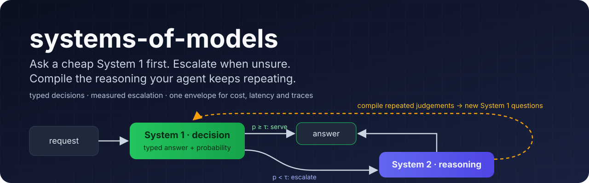
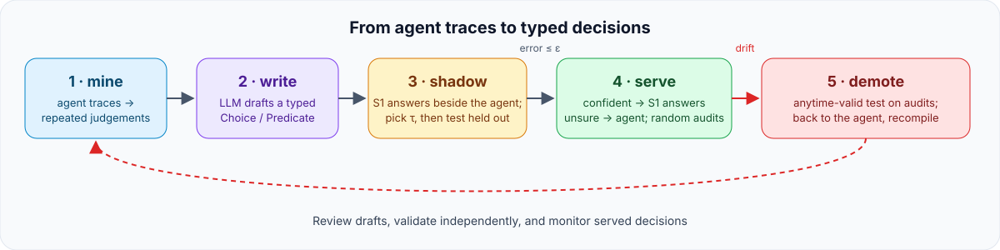
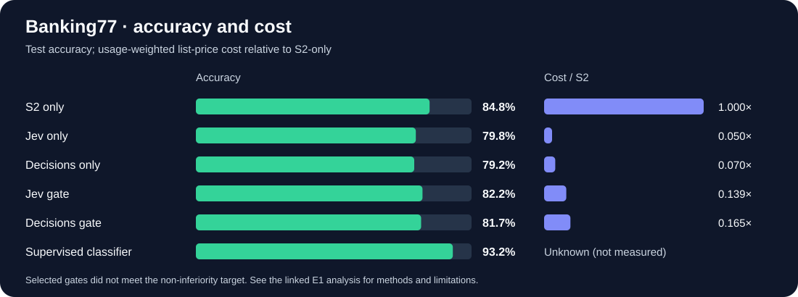

<p align="center">
  
</p>

<p align="center">
  <a href="https://pypi.org/project/systems-of-models/"></a>
  <a href="https://github.com/edwinjosechittilappilly/systems-of-models/actions/workflows/ci.yml"></a>
  <a href="https://github.com/edwinjosechittilappilly/systems-of-models/actions/workflows/codeql.yml"></a>
  
  <a href="LICENSE"></a>
  <a href="schemas/"></a>
  
</p>

<p align="center">
  <a href="#quick-start">Quick start</a> ·
  <a href="#use-cases">Use cases</a> ·
  <a href="#results">Results</a> ·
  <a href="#drop-in-for-what-you-already-use">Drop-in</a> ·
  <a href="#compile-what-your-agent-repeats">Compile loop</a> ·
  <a href="#the-contract">Contract</a> ·
  <a href="#reproduce-the-paper">Reproduce</a>
</p>

# systems-of-models

**Put a typed decision in front of a reasoning model.** Ask a decision API first, escalate uncertain answers,
and record cost, latency and provenance in a shared envelope. For repeated agent judgements, mine traces and
evaluate a compiled question before serving it. Measure the trade-off on your own traffic.

## Why systems-of-models?

| Need | Approach |
|---|---|
| Control inference cost | Route uncertain decisions to a stronger model; measure accuracy and cost together. |
| Observe heterogeneous calls | Wrap supported clients and record a common response envelope. |
| Reuse repeated judgements | Mine traces, draft typed questions, validate on held-out data and audit served answers. |
| Account for change | Use versioned schemas, explicit escalation and lifecycle records. |

```bash
pip install "systems-of-models[openai]"
```

## Quick start

```python
import som
from som.testing import FunctionDecider

question = som.Choice("team", "Which team should handle this ticket?", ["billing", "cards", "fraud"])
fit = som.Predicate("fits", "Does the ticket fit one of these teams?")

def answer(text, q):
    if q.name == "fits":
        return som.PredicateAnswer(q.name, 0.95)
    return som.ChoiceAnswer(q.name, "billing", {"billing": 0.9, "cards": 0.05, "fraud": 0.05})

gate = som.Gate(FunctionDecider(answer), FunctionDecider(answer, system="s2.reasoning"),
                question, threshold=0.8, fit=fit, fit_threshold=0.5)
result = gate("I was charged twice for the same coffee")
print(result.value, result.served_by, result.in_scope)  # billing s1 True
```

This example uses offline stand-ins, not a model. Replace them with provider adapters such as `som.TypeSafe`
and `som.OpenAIResponses` and configure credentials to make real calls. A refused or out-of-scope result needs
explicit handling; `result.value` is `None` in either case.

No keys yet? `som demo` replays 20 real recorded decisions offline, and `som breakeven` tells you when a gate pays off:

```bash
som demo
som breakeven --c1 0.00004 --c2 0.0025 --escalated-c2 0.0031 --escalation-rate 0.3
```

## How it works

<p align="center"></p>

| Piece | What it does |
|---|---|
| `som.Gate` | Asks System 1 a typed question. If the chosen answer's probability is below `threshold` (or a companion "does anything fit?" predicate says no), it escalates to System 2 and records why. |
| Envelopes | Every call returns an envelope that validates against the JSON Schemas in [`schemas/`](schemas/): system, model, confidence and its basis, cost and how it was obtained, latency, W3C trace IDs. |
| `som.compile` | Mines agent traces for repeated judgements nobody declared, writes a typed question for each, promotes it only if it meets an error target on held-out shadow traffic, audits it while serving and demotes it with an anytime-valid test. |
| Adapters | TypeSafe Jev, OpenAI Decisions, Responses and Chat (plus Ollama, vLLM, OpenRouter, LiteLLM proxy), Anthropic, Gemini. Each takes the client you already have. |

## Use cases

| You have... | Ask System 1 | Escalate when |
|---|---|---|
| A support inbox | `Choice`: which queue? `Predicate`: is this a refund request? | the queue's probability < 0.8, or nothing fits |
| An agent with tools | `Predicate`: does this action change account access? | unsure: let the agent reason; served answers skip a reasoning turn |
| A RAG pipeline | `Score`: how relevant is this passage? | the score is in the uncertain band |
| LLM output checks | `Predicate`: does the answer follow from the cited paragraph? | the check is unsure or fails: send to a reasoning model or a person |
| Moderation | `Choice`: spam / abuse / fine, plus a companion "is this any of these?" | low probability on a high-stakes label |

## When to use / when not to

| Situation | Starting point | Caveat |
|---|---|---|
| You have labelled examples | Train and evaluate a classifier | The supervised embedding baseline reached 93.2% on Banking77; its local cost was not measured. |
| You lack labels but have a defined answer space | Evaluate a decision API and gate | Selected gates cost less than S2 alone in E1, but did not meet the non-inferiority target. |
| An agent repeatedly makes the same judgement | Mine traces and evaluate a compiled question | Discovery produced false positives; inspect drafts and validate on independent traffic. |

## Related tools

| Approach | Main focus | Relationship |
|---|---|---|
| [RouteLLM](https://github.com/lm-sys/RouteLLM) | Route requests between language models | Routing is complementary to typed decisions and trace mining. |
| [TRACER](https://arxiv.org/abs/2604.14531) | Learn surrogates from agent traces | Closely related trace-based reuse of agent behaviour. |
| [DSPy](https://dspy.ai/) | Program and optimize language-model pipelines | Can define and optimize LM modules; typed-question generation is prior art. |
| [TypeSafe Autoresearch](https://docs.typesafe.ai/cookbooks/autoresearch_feature_discovery) | Generate and evaluate typed questions | Prior art for model-written typed questions. |

## Results

Measured on Banking77 and CLINC150 test sets and published τ²-bench traces. Costs are usage-weighted list
prices, not bills; cost ratios use S2-only as the denominator. Results are task- and model-dependent.

<p align="center"></p>

| Experiment | Result | Evidence |
|---|---|---|
| E1 · Banking77 | S2 84.8%; Jev 79.8% at 0.050× S2 cost, Decisions 79.2% at 0.070×. Jev gate 82.2% at 0.139×; Decisions gate 81.7% at 0.165×. | [Baselines](bench/results/e1/full/baselines.csv), [gates](bench/results/e1/full/selected.csv) |
| E1 · CLINC150 | S2 94.4%; Jev 88.2% at 0.086× S2 cost, Decisions 77.2% at 0.117×. Jev gate 91.7% at 0.315×; Decisions gate 91.8% at 0.486×. | [Baselines](bench/results/e1/full/baselines.csv), [gates](bench/results/e1/full/selected.csv) |
| E1 · supervised | Banking77 93.2%; CLINC150 90.6%; local monetary cost unknown. | [Analysis](bench/results/e1/full/ANALYSIS.md) |
| E2 · CLINC150 out-of-scope detection | Raw fit-predicate AUROC: Jev 0.976, Decisions 0.935. | [Metrics](bench/results/e2/full/metrics.csv) |
| E3b · discovery | Pooled miner precision/recall 0.254/0.750; accept-all-branches baseline 0.517/0.750. | [Discovery](bench/results/e3b/tau2-768f3d8/discovery.csv) |
| E3b · held-out agreement | 97.0% pooled teacher agreement over two evaluated decisions, full state. | [Analysis](bench/results/e3b/tau2-768f3d8/ANALYSIS.md) |
| E4 · contract validity | 54,385/54,385 cached envelopes valid against contract **2.0.0**. | [Analysis](bench/results/e4/contracts-v2-dev/ANALYSIS.md) |

E3a (runtime compilation under shift): results pending

E1's selected gates did **not** meet the stated non-inferiority target. E3b's revisions followed observed results,
the branch baseline has the same recall and higher precision, and prior assistant text may reveal the answer.
See the linked analyses for calibration, data leakage, and measurement limitations.

## Drop-in for what you already use

```python
import som
from openai import OpenAI

client = som.wrap(OpenAI())  # requires OPENAI_API_KEY; proxy observes supported create calls
response = client.responses.create(model="gpt-6.1-terra", input="Hello")
observation = som.envelope_of(response)  # may be None if no recent envelope is available
if observation is not None:
    print(observation.cost)
```

| Integration | How |
|---|---|
| OpenAI SDK | `som.wrap(OpenAI())` or `AsyncOpenAI()`; streams included. Observability only; gating needs `Gate`. |
| OpenTelemetry | Install `systems-of-models[otel]`; every call is a span with `gen_ai.*` attributes under your current span. |
| LangChain | `GateRunnable(gate)` (`systems-of-models[langchain]`). |
| MCP | `som mcp-serve --s1 typesafe:jev-1.14.0` exposes a `decide` tool to any MCP client (`systems-of-models[mcp]`). |
| Async bulk | `som.AsyncGate(gate, max_concurrency=10)`. |
| Local models | `som.OpenAIChat.ollama("qwen3.5:2b")`, `.vllm(...)`; cost basis `local_measured`. |

More in [`docs/cli.md`](docs/cli.md), [`docs/integrations.md`](docs/integrations.md) and [`docs/wrap.md`](docs/wrap.md).

## Compile what your agent repeats

```python
from som.compile import AgentStep, AgentTrace, CompiledDecision, mine, write_question

traces = [
    AgentTrace("1", "Cancel my order", [AgentStep("cancel", {}, "done")]),
    AgentTrace("2", "Where is my order?", []),
]
report = mine(traces, min_support=1)
question, provenance = write_question(
    report.accepted[0],
    lambda context: {"name": "cancel", "instructions": "Does the request ask to cancel?"},
    seed=0,
)
decision = CompiledDecision(epsilon=0.05, alpha=0.05, n_cal=150, n_val=150, audit_rate=0.2)
decision.start_shadow()
print(question.name, decision.state)
```

This offline writer is illustrative; production drafts need review. The lifecycle separates calibration from
validation and requires callers to route requests and independently sample audits. Under the assumptions in
[`lifecycle.py`](src/som/compile/lifecycle.py), an audit e-process controls false demotion at `alpha`.

## The contract

The JSON Schemas in [`schemas/`](schemas/) define five systems, a shared response envelope and an escalation
protocol. Contract 2.1.0 adds the `rollback` patch kind to the meta-layer; costs identify their basis
(`provider_reported`, `list_price`, `local_measured` or `unknown`).

```bash
som check-schemas                       # schemas and examples
som validate envelope.json --schema s1-decision
```

From Python: `som.schemas.validate(instance, "envelope")`. Each schema's `$id` resolves to its raw file here, so
`$ref`s work over the network as well as locally.

## Reproduce the paper

```bash
git clone https://github.com/edwinjosechittilappilly/systems-of-models && cd systems-of-models
uv sync --all-groups
make test test-bench                    # offline
uv run python -m bench.e1_e2.run --mode replay
```

Live mode (`--mode record`) needs `OPENAI_API_KEY` and `TYPESAFE_API_KEY` in `.env` (see `.env.example`).

## Citation

See [`CITATION.cff`](CITATION.cff):

```bibtex
@misc{jose2026systems,
  author = {Jose, Edwin},
  title = {Beyond System 2: A Taxonomy and API Contracts for Systems of Models},
  year = {2026}
}
```

## License

MIT, see [`LICENSE`](LICENSE).
